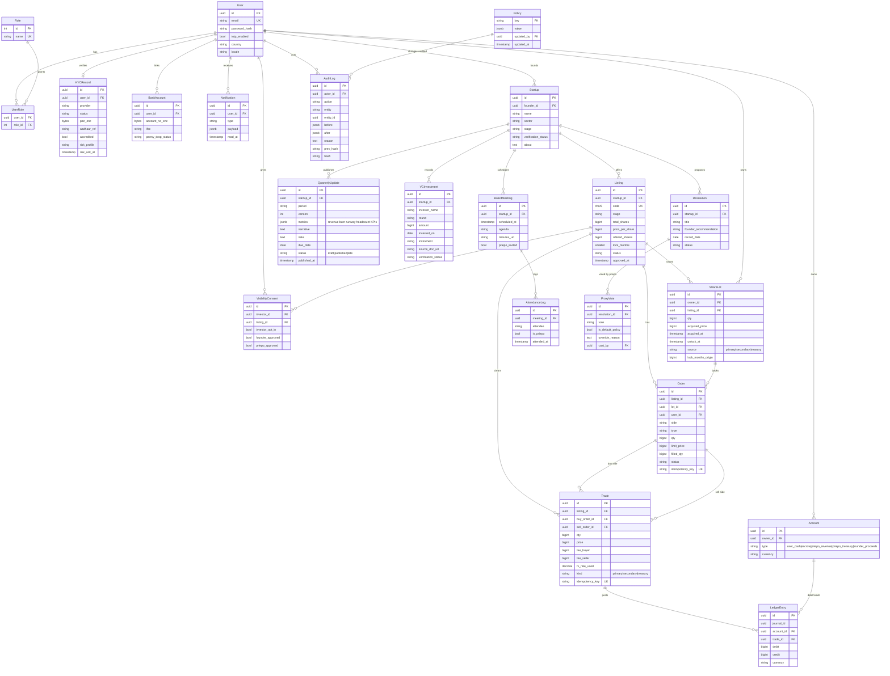

# priepo – ER Diagram

Money columns are `BIGINT` minor units plus `currency`. All tables have `id`, `created_at`. `AuditLog` and `LedgerEntry` are append-only.

## Key constraints

- `Listing.code`: unique, 5 chars from the allowed alphabet, immutable (trigger).
- `LedgerEntry`: for each `journal_id`, `SUM(debit) = SUM(credit)` (deferred constraint). Account balances can't go below zero for `user_cash` and `escrow`.
- `ShareLot.qty >= 0`, and `SUM(qty)` per listing never exceeds `total_shares` (row lock plus check).
- `AuditLog`: insert-only (revoked UPDATE/DELETE), hash-chained.
- `Trade.idempotency_key` and `Order.idempotency_key`: unique.
